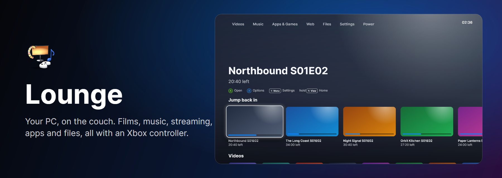

<div align="center">



**Your PC, on the couch. A media center you drive entirely with an Xbox controller.**

[](#install)
[](#build-from-source)
[](#build-from-source)
[](#the-player)
[](LICENSE.txt)

</div>

---

Lounge opens straight into a full-screen, big-picture home and never asks for a
keyboard or a mouse. Films and shows play in its own player (a C# port of
[tivi](../tivi), on the same FFmpeg 8 build), music has a proper Now Playing, the
web's streaming services run inside it, your apps and games launch from tiles,
and a controller file explorer renames, copies and deletes with an on-screen
keyboard. Every button can be remapped and every behaviour has a setting.

## Install

Download `Lounge-Setup-<version>.exe` from [Releases](../../releases) and run it.
The build is self-contained; there is nothing else to install. Video and music
decode with the bundled FFmpeg; web tiles use Microsoft's WebView2 runtime, which
Windows 10 and 11 already have (Lounge offers to fetch it if not).

When a controller connects later, a small helper offers *"Would you like to go to
Lounge?"*. Press Ⓐ for yes, Ⓑ for not now.

## On the couch

| Button | Everywhere | While watching |
|---|---|---|
| Ⓐ | Select (hold on a home tile to pick it up and move it) | Play / pause |
| Ⓑ | Back | Stop |
| Ⓧ / Ⓨ | Options on the focused item / search | Info / audio, subtitles and picture |
| D-pad, left stick | Move | Skip ±10 s (left/right), ±60 s (up/down) |
| RB / LB | Volume up / down | Volume up / down |
| RT / LT | Next / previous section | **Fast forward / rewind**: the harder you press, the faster (2× plays at double speed; 4×–32× scrubs through a preview strip and settles exactly where you let go) |
| Menu | Settings | Settings |
| View | Options menu | Options menu |
| Hold View | Home | Home |
| Hold View + Menu | | In any app Lounge launched: come back to Lounge |
| Hold View + B | Controller mouse on/off | |

All of it is remappable in **Settings → Controller → Remote**, which draws the
controller, shows what each button does in each context (menus, watching, the
keyboard, files, web pages, controller mouse, while an app runs), and rebinds a
button by pressing the new one. Holds and combinations work too.

## What is inside

- **Five themes, five homes.** Aurora (Apple TV-like hero and rows), Living Room
  (a smart-TV launcher ribbon), Kodi Classic (the XBMC side menu over fanart),
  Console One (a PS5-style icon row) and Series (an Xbox-style tile grid). Each
  has its own colours, motion, interface sounds, original ambient music and its
  own wallpaper (any picture from Files). Tiles can be pinned to the front,
  moved and hidden.
- **The player.** FFmpeg 8 with D3D11VA hardware decoding, a YUV→RGB shader
  (BT.709/601, picture adjustments), audio as the master clock, exact seeks,
  pitch-correct speed, libass subtitles with automatic sidecar pickup
  (`movie.en.srt`), bitmap subtitles (PGS, VobSub), resume, chapters and
  "Next up". Lounge keeps its own `config.ini` and `history.ini` in tivi's formats.
- **Music.** Albums, artists and songs from your folders' tags and covers, with
  Now Playing, a queue, shuffle and repeat. It keeps playing while you browse.
- **Ambient music** like a console home screen: soft, original, generated per
  theme (or your own folder), fading out whenever anything else plays.
- **Web.** YouTube's TV interface, Netflix, Disney+, Prime Video, HBO Max and Twitch tiles
  run inside Lounge, and pages read the controller themselves. If a service
  refuses protected video in the embedded view, one choice opens it in your
  full browser.
- **Apps and games.** Cogas opens straight into Big Picture, Steam into Big
  Picture, and anything in your Start Menu or on disk can become a tile. While
  an app runs, Lounge steps aside and listens only for the return combination.
- **Files.** Drives and folders, play anything, view pictures, rename with the
  controller keyboard (the extension stays locked), copy, cut, paste, new
  folder, delete to the Recycle Bin, add library folders, set a wallpaper.
- **Settings, tivi style.** A slide-in panel generated from one schema: every
  behaviour, path and number is there, each with Reset to default.

## Build from source

Requires the .NET 10 SDK and MSYS2 mingw64 with FFmpeg 8 and libass (the same
packages tivi builds against). Forge is needed only for the installer.

```powershell
.\tools\fetch-native.ps1   # stage FFmpeg + libass DLLs into native\win-x64
.\build.ps1                # tests, controller-flow checks, previews, publish to dist\Lounge
.\installer.ps1 -SkipBuild # dist\installer\Lounge-Setup-<version>.exe
```

Command line: `Lounge.exe --help` lists `--windowed`, `--play <file>`,
`--files <folder>` and `--selftest`.

## Verification

- `dotnet test tests` runs the Core and media tests: the router's press, hold,
  chord and trigger logic, settings and keymap persistence, tivi-format history,
  file operations, the library scanner, focus navigation, and the FFmpeg engine
  against generated clips (exact seek within a frame, scrub, 2× speed, subtitles,
  10-bit HEVC).
- `dotnet run --project tools/Checks` drives the real screens with a virtual
  controller: navigate, change the theme, add a library folder, rename a file,
  copy and paste, remap a button, play and seek, and the dormant return chord.
- `dotnet run --project tools/Preview -- dist/preview` renders every screen in
  every theme to PNG, headlessly.

Data lives in `%APPDATA%\fezcode\Lounge`.
